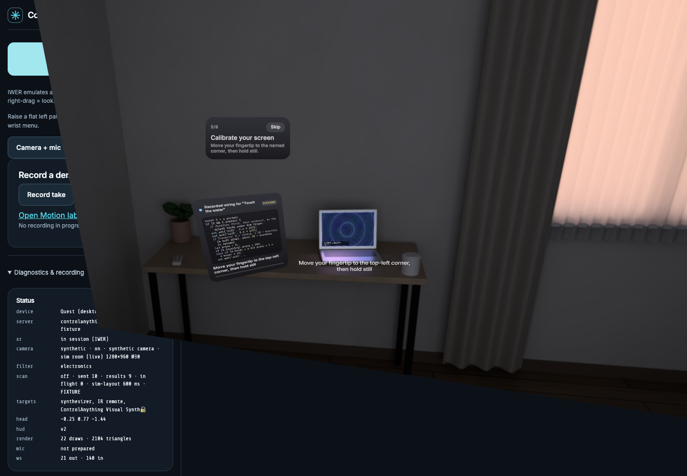

# ControlAnything

**Pinch a device, ask Muse what your hands should do, and watch it write the connection.**

ControlAnything connects a Meta Quest 3 to supported hardware and software through a server on your laptop. Meta's SAM 3.1 outlines objects in passthrough. You select a device and ask what your hands should do. After you ask, Muse Spark writes and tests a Node connector on your Mac and designs an AR instrument for it. You watch the code and terminal stream in AR. An optional hand program runs in a restricted Web Worker on the headset; generated controls send their values to the connector through the Mac bridge.

<!-- VIDEO_URL -->
**▶ 3-minute demo video:** _link coming soon_

<p align="center"><br><sub>Current desktop emulator during screen calibration, with requested code and its FIXTURE label visible. The scene is simulated; this is not real-headset or live-generation evidence.</sub></p>

Built for the **Meta Global AI Developer Hackathon** (Indie Developer track, *Push the Frontier*). The name nods to Meta's *Segment Anything*; this is an independent project, not a Meta product.

## No headset? Use your camera

Open **[/quest/reviewer.html](http://localhost:8787/quest/reviewer.html)** on the running server. It supports a laptop webcam or phone camera, an animated Buddy with explicit photo preview/retake, and the same Muse coding-agent path to touch-playable software instruments. Choose **Connect demo → Ask Muse to build it**; no controls are pre-wired. A browser that supports native mobile WebXR also offers **Place Buddy in AR**. Other browsers use camera + touch, with their limits stated on screen. See the [reviewer guide](docs/REVIEWER-DEMO.md) for HTTPS, pairing, fixture labels and verification boundaries.

## The golden path

ControlAnything has two layers. **Annotate** looks at the room: SAM 3.1 outlines objects in passthrough, your hands are tracked, and a pinch tags (and keeps tracking) the object you mean. **Control** is where the **Muse agent** on your Mac writes the connection: you ask, Muse codes, tests and deploys the glue, and the controls appear in AR.

1. **Enter AR and tag an object.** Annotate is the default. Pick **Electronics / Objects / All** in the wrist menu (raise a flat left palm). Pinch an outline to tag it; you stay in Annotate.
2. **Choose Control.** The selected object's card asks what you want. If it needs a companion (a USB-MIDI synth needs the Mac), the card says so and offers **Connect Mac**: look at the QR code on the Mac app with the headset, then plug the device into the Mac. There is no Set up / Enable ceremony first.
3. **Ask Muse.** Tap a suggestion or hold the mic and say it: *"Give me knobs for the filter"*, *"Play it with my hands"*, *"Write a controller for the visual synth"*, *"Touch the water"*.
4. **Watch Muse work.** The Muse agent (Muse Spark with real tools) looks at the snapshot of the object, uses a terminal on the Mac, writes a connector program, starts it as a background service, sends test values to the real device and reads the acknowledgements, fixes what fails, and keeps notes for next time. Its terminal and code stream into a card beside the device; the Mac speaks its progress lines.
5. **Use the controls it made.** Generated **AR keys, pads, XY surfaces and colored controls** appear between you and the device: pinch a knob and twist it like a real one, or pinch and drag up/down. If you asked for hand control, Muse's hand program runs in a sandboxed Worker on the headset (screen-touch programs ask you to calibrate two screen corners first).
6. **Stop.** Both palms out stops the current controls and shuts the connector down; ask again for something new. **Stop all** in the wrist menu stops everything; hold **Exit** to leave AR.

### The Muse agent (a coding agent on the Mac)

`apps/server/src/agent/muse-agent.ts` is a Hermes-style agent loop on the Meta Model API (`muse-spark-1.3`, function calling, streamed). Its tools:

| Tool | What it does |
|---|---|
| `bash` | Runs shell commands in its workspace on the Mac (inspect, `npm install`, run scripts and tests). Obvious system-level/destructive commands are filtered; the process still has the Mac user’s OS permissions. |
| `read_file` / `write_file` / `edit_file` | Reads the workspace and this repo; writes only inside the workspace. Files stream into AR as they are written. |
| `deploy_connector` | Starts `node <entry>` as a background service for the selected device and declares the actions it accepts. A crash on start comes back with its stack trace. |
| `test_action` | Sends a value to the running connector, exactly as an AR control would, and returns the connector's log plus the device acknowledgements from the Mac companion. |
| `open_visuals` | Opens the visual synth on the paired Mac. |
| `say` | One progress line for the wearer (shown in AR, spoken by macOS speech). |
| `finish` | Hands over AR controls bound to connector actions, and/or a hand program; the server validates and dry-runs the program and sends back any issues to fix. |

The workspace (`apps/server/.data/muse-agent/`) persists: `connectors/<device>/index.mjs`, `NOTES.md` (its memory), and `ce.mjs`, the small runtime a connector imports (`onSet`, `onTrigger`, `onStop`, `midi.cc/note/program`, `log`). MIDI goes out through the paired Mac companion's Web MIDI (USB synths, plus the built-in visual and musical synths); anything else (HTTP to a lamp, `say`, a serial port) the connector does itself in Node. Owner/localhost status: `GET /api/agent/connectors`. Limits: 24 turns, 40 tool calls, 5 minutes per request. Without an API key the same tools replay a scripted **FIXTURE** run. `CE_AGENT=0` restores the older bounded wiring harness and setup flow.

Verified on the real Quest on Nov 4: the user confirmed the live visual-synth/water interaction and Air Theremin; OP-1 notes and CCs arrived after MIDI receive was enabled on the instrument itself. Direct Bluetooth tests moved the physical OM 4, but a Muse-driven gimbal interaction has not yet been accepted end to end on the headset. The new rich instrument UI and camera-reviewer changes are verified separately in the emulator/browser, not yet on physical phones or the Quest. A separate live Muse Spark sanity probe generated the new instrument UI in 30.4 s with fake MIDI acknowledgements; that is live generation evidence, not physical-output evidence.

**Optional musical route:** choose **More → Music** to open **ControlAnything Synth**, a separate browser instrument on the paired Mac. Sound is audible by default after the first Mac interaction unlocks browser audio; there is no extra Sound on gate. Ask Muse how your hands should play. Muse writes the note/gate and parameter mapping after the request; there is no built-in playable hand preset. The authored engine provides a two-octave C minor scale, filter, envelope, delay and three sound presets. Both palms stop the current wiring and release its note, keeping the checked instrument ready for another ask. **Stop all**, closing/hiding the panel or disconnecting releases notes and delay tails; an old program never resumes. One shared master volume/mute controls Mac and headset sounds. This route does not send physical MIDI. The revised instrument UI still needs a fresh real-headset comfort/listening check; muted automation uses `/companion/?mute=1`.

## Meta model calls vs. OS and browser features

**Every AI model this project calls at runtime is a Meta model**, called through Meta's Model API. The application does not call or bundle a non-Meta model. Platform tracking and system voices are described separately below.

| Meta model | What it does here |
|---|---|
| **SAM 3.1** (`sam-3.1`) | Finds and outlines the devices and objects in passthrough frames: every box you see comes from it. During verification it finds the same outline again on the before and after frames. |
| **Muse Spark** (`muse-spark-1.3`) | Drives the **Muse agent**: with terminal, file, deploy and test tools it writes, runs and fixes the connector for the selected device and generates its AR controls and hand program. Identifies the pinched device from a crop and the whole frame. Writes the driver from the device's capability manifest or MIDI chart (older setup flow). Writes the per-request JavaScript wiring and control descriptions, with repair when checks fail. Native Muse Code uses it to develop connector project code with file and terminal tools. Also writes the Muse buddy’s reactions to real camera photos and explicitly shared virtual objects. |
| **Muse Wonder** (`muse-wonder-1.0`) | Guarded fallback for driver generation and older experimental paths. The normal gesture-program harness is pinned to Muse Spark; only count Wonder as used when a call actually occurred. |
| **Muse Image** (`muse-image-1.0`) | Paints the buddy's stickers. Optionally paints a device-inspired panel texture, which never delays the controls. |
| **Muse Voice Transcribe** (`muse-voice-transcribe-1.0`) | Transcribes the device card’s hold-to-talk wiring request, plus the older lab assistant and spoken verification clips. |

These parts are OS or browser features, or plain code. None of them is an AI model call:

| Part | What it actually is |
|---|---|
| Hand and head tracking | Quest OS hand tracking, read through the WebXR Hand Input API. We read the joint poses and run no hand model of our own. |
| Hand/screen signals and UI gestures | Deterministic geometry on WebXR joints, with smoothing and a calibrated screen plane. Muse’s generated program decides how these signals drive the selected device. |
| An object you hold as a controller | Follows the hand that holds it (WebXR joints). SAM 3.1 finds it first. |
| Camera verification (*seen ✓*) | Deterministic before/after frame comparison inside the SAM 3.1 outline. |
| Passthrough frames | Quest Browser camera access (`getUserMedia`). |
| The Mac visual synth | A WebGL shader with procedural Web Audio splash, wake and hover sounds in Chrome. |
| The Mac musical synth | An authored Web Audio instrument in Chrome; sound requires an explicit Mac click. Muse writes its hand wiring, not the oscillator/effect engine. |
| App voices, reactions and UI sounds | Browser `speechSynthesis`, macOS OS speech, and procedural Web Audio tones/noise; no non-Meta AI voice model. Shared master volume/mute applies across Quest and Mac. |
| Mac speech and music actions | macOS speech and AppleScript (Music), which are OS features. Live startup leaves `CE_MAC_SILENT` unset; explicit muted automation can still use it. |
| iPhone spoken replies | The iOS system voice (`AVSpeechSynthesizer`). |
| Device links | Web MIDI, Web Serial and Web Bluetooth (browser), bleak (Bluetooth LE), stored IR codes. |
| QR pairing | jsQR decoding (not a model). |

## What Muse writes, and where it runs

| Artifact | Generated from | Checked and executed where |
|---|---|---|
| **Connector** (Muse agent) | The wearer’s request, the object snapshot, the Mac’s MIDI ports and the instrument manifests | A Node program in the agent workspace, run as a background process on the Mac and tested by the agent against the device. It sends MIDI through the paired companion’s Web MIDI. Stopped on Stop / Stop all / a new ask. |
| **AR controls** (Muse agent) | The connector’s declared actions and the request | A validated 3D instrument specification with keys, pads, XY surfaces, knobs, buttons or toggles, drawn beside the device; each change is a `wire:<action>` control event to the connector. |
| **Driver** | The instrument’s capability manifest or reviewed device/MIDI data | Declarative operations validated on the server against supported transports, action IDs, CCs and ranges. Executors send those operations; driver JSON is not arbitrary executable code. |
| **Wiring program** | The wearer’s current request, available hand/screen signals and verified driver actions | Up to 4KB of JavaScript, validated and dry-run in a restricted `node:vm` context on the server. The accepted program runs every frame in a restricted **Web Worker on the Quest**. It never runs in the Mac companion. |
| **Labels/interface description** | Device actions and the request | Bound to validated actions and rendered in the app’s established AR layout. The current demo does not generate arbitrary 3D scene code. |

The wiring API is `wire(s, out, mem)`: read hand/screen signals, call `out.set(actionId, value)` or `out.trigger(actionId)`, and retain small state in `mem`. The runtime restricts actions, clamps values, rate-limits outputs and stops on repeated errors or a watchdog timeout. The server independently checks active wiring, arming and verification before dispatch. These are prototype guardrails, not a general-purpose untrusted-code platform.

Live generation is the normal keyed route. The gesture-program harness fails visibly if Muse cannot finish checked code; it installs no implicit template. Older experimental generation paths can show a **Template**, labelled *no Meta model wrote this*. No-key runs are **FIXTURE**, including scripted tool calls and chunked code playback. Driver-library reuse is labelled separately and does not mean the wiring was newly generated. Each new wiring request still asks for a new program; this path does not silently restore an old hand mapping.

After Muse finishes, each hand frame needs **no model call**: worker output → `control.event` (`wire:<actionId>`) → validated driver → Mac executor/renderer. See [architecture](docs/ARCHITECTURE.md) for the protocol and limits.

**Evidence boundary:** the earlier real-Quest dial/Perform build reached 81 fps at p95 and applied 100/100 commands in a November 4 run. A separate live Muse wiring probe streamed **Touch the water** in 14 deltas and reached ready in 8.1 seconds; **Hands as knobs** took about 11 seconds. These are separate measurements, not a measured end-to-end touch-water headset pass. The current ask → code → calibrate → touch route needs its own real-headset acceptance record.

## Honest verification

Muse can test connector actions and reports the returned acknowledgements. Those receipts establish transport/software results, not an independently observed physical effect. The older setup harness additionally uses these verification labels:

| Label | Meaning |
|---|---|
| **seen ✓** | The headset camera saw the change: before/after frames, mask vs ring, deterministic, no model. |
| **renderer ✓** | The camera did not see a change, so the Mac's renderer reports what it applied (*verified by renderer: warp …*). |
| **acknowledged ✓** | Only the executor's acknowledgement. The bytes went out; nothing confirmed the effect. |
| **not seen ✗** | Failed. That control stays locked. |

In emulator runs, the camera at about 1 m usually does **not** see the Mac's screen change. Those passes are *renderer ✓* or *acknowledged ✓*, and they say so. A send alone never counts as proof for a lamp or a synth that the camera or microphone can check.

## More than one synth

- **Muse buddy.** *Wrist palette → More → Buddy.* An animated desk companion waves, responds to touch and high fives, and reacts to real or virtual objects. Capture previews the exact photo; Show Buddy sends it, while Retake discards it locally. Muse Spark writes the reaction and Muse Image can paint a shelf sticker. There are no quests or scores.
- **Physical objects as controllers.** Once a device is armed, choose *Use an object* and pick a mug or bottle. SAM 3.1 finds it; once you pick it up it follows the hand that holds it (WebXR joints, One Euro filter). Lifting it drives the first control and sliding it drives the second. This is an earlier deterministic controller mode, not proof that Muse generated its hand-to-object behavior; it is outside the new wiring demo.
- **DJI Osmo gimbal.** A Bluetooth adapter for the Osmo Mobile: DUML framing, a safety envelope (≤ 90°/s, pan ±120°, tilt ±45°) and three links (`CE_OSMO=ble` via a small bleak helper, `web` via Chrome Web Bluetooth, `mock`). Server integration covers identify, link, driver and controls. Current evidence is mock/terminal testing, not a demonstrated headset-driven physical move. A physical move test is `npx tsx apps/server/scripts/osmo.ts test --move`.
- **Hand and head pose recording.** Record a take from the headset: passthrough video plus head and 25-joint hand poses at up to 30 Hz. On the Quest it is under `?lab=1`; in the emulator it is in the side panel. Review it in **Motion lab** (`/companion/tracking/`): video and 3D hands on one timeline, tracking gaps, *Export dataset* for physical-AI training data. See [tracking review](docs/TRACKING-REVIEW.md).
- **Additional hardware.** Verification is specific to each route:
  - OP-1 Field notes/CCs over USB-MIDI were confirmed with the earlier UI; the revised instrument UI needs fresh acceptance;
  - the IR ceiling-light path through an M5Stack Cardputer still needs physical acceptance;
  - native iPhone, DevTerm and Cardputer clients pair by QR code or passcode; their device acceptance is separate from the browser reviewer demo.

## Judge path (no hardware)

Needs **Node 22.12+** and **Chrome**. No API key: without one, the server replays recorded real responses, labelled **FIXTURE**.

```sh
npm install
npm run demo:sim            # builds what's missing; attended demo with sound on :8787
```

1. Open **[the sim room](http://localhost:8787/sim/)** first. It stands in for your Mac: it pairs itself on localhost, and the laptop on its desk runs the visual synth.
2. Open **[the desktop Quest emulator](http://localhost:8787/quest/?emulate=1&camera=sim&mic=0)** and choose **Enter AR**. Click = pinch, right-drag = look, W/A/D/Q/E = move.
3. **Click the laptop’s box** to tag it, press `M` (or the wrist menu) for **Control**, then choose a suggestion on the device card. The scripted FIXTURE agent writes a visual-synth connector and returns knobs and/or a touch program.
4. Follow calibration, then use the emulated tracked hand to touch the screen. The automated wiring check below supplies fingertip poses; ordinary mouse clicks are UI pinches, not physical screen contact. **Stop** is on the wrist palette or the `X` key. Keys: `G` Visual synth, `1/2/3` Electronics/Objects/All (Annotate only), `B` Buddy.

To see the real Mac app instead, open [the companion](http://localhost:8787/companion/) in a tab. Choose **More → Visual synth** in AR or **Open visuals** on the Mac to open the optional instrument. Model ids and latency are at [`/api/muse/calls`](http://localhost:8787/api/muse/calls). The agent's steps and evidence are at `/api/agent/steps` and `/api/agent/targets`.

**Automated check** (installed Chrome; its own muted fixture server, own data dir):

```sh
npm run build                         # only while no live AR session is using dist
node scripts/e2e-muse-agent.mjs        # Muse agent golden path: tag -> Control -> ask -> knobs -> MIDI -> Stop
PORT=8796 node scripts/e2e-judge.mjs   # older setup-first water flow (CE_AGENT=0)
node --import tsx apps/server/scripts/wire-e2e.ts  # fixture WIRE over WebSocket
```

For unattended playback, use `npm run demo:sim -- --mute`; attended demos keep sound on after a browser gesture.

These checks use server fixture detections. They do not measure detector accuracy, headset frame rate or the real Mac display.

## Run it with hardware

1. **Mac:** put `MODEL_API_KEY` in `.env` for live Meta models. Build before opening the app, then run `CE_DEMO=1 npm start` with `CE_MAC_SILENT` unset. HTTP serves on :8787 and HTTPS on :8443. The first click/Enter AR unlocks browser audio; a shared visible volume/mute controls the demo.

2. **Quest 3** (developer mode, USB-C): `sh scripts/quest-grant-camera.sh` grants camera access and sets up `adb reverse`. In Quest Browser, open `http://localhost:8787/quest/` and choose **Enter AR**. Over the LAN, use `https://<mac-ip>:8443/quest/` and accept the development certificate.
3. **Companion:** open `http://localhost:8787/companion/` in its own Chrome window, full screen. Look at its QR code from the headset.
4. **Tag, choose Control, then ask Muse.** Plug USB-MIDI devices into the Mac and click **Enable MIDI** on the companion once. Select the object in Control, choose a suggestion or hold-to-talk, and watch Muse write and test the connector; then use the AR knobs or your hands. For the water demo, ask the laptop for the visual synth (or choose **More → Visual synth**).

While a live session is open, rebuild with `scripts/deploy-live.sh quest` (or `companion` / `sim`), which preserves old chunks. Reload the single Quest tab only after leaving AR; `scripts/quest-reload.mjs` avoids opening a duplicate camera-owning tab.

Checklist and recording guide: [docs/DEMO-ACCEPTANCE.md](docs/DEMO-ACCEPTANCE.md). Per-app notes:
- [server and pairing API](apps/server/README.md)
- [Mac companion](apps/companion/README.md)
- [sim room](apps/sim/README.md)
- [DevTerm](apps/devterm/README.md)
- [Cardputer firmware](firmware/cardputer/README.md)
- the iPhone project, `apps/iphone/` (iOS 17+)

Use your own devices on a trusted network; this is not for safety-critical equipment.

Development: `npm run typecheck`, `npm test`, `npm run build`.

## Architecture

Quest (WebXR, three.js) ⇄ WebSocket hub ⇄ one Node server on the Mac (Meta model adapters, agent, oracles, forge) ⇄ executors (Mac companion, sim, Cardputer, iPhone, DevTerm, Osmo bridge). The protocol, the agent state machine, the oracles and the generated-controls format are described in **[docs/ARCHITECTURE.md](docs/ARCHITECTURE.md)**.

## Built during the hackathon

The application code, clients, firmware, prompts, device data and simulated room were built during the Meta Global AI Developer Hackathon, **Oct 26 – Nov 4, 2026**, for submission by Nov 5, 11:00 JST. The hardware, the pretrained models and the third-party libraries and assets below were not built by us. The DJI Osmo gimbal adapter (`apps/server/src/devices/osmo/`) is new code written during the hackathon; it draws on public protocol research (below) and on the author's own earlier, private notes on the gimbal's Bluetooth protocol (March 2026, documentation only), from which no code is included.

## Credits and licences

Repository code: **MIT** ([LICENSE](LICENSE)). Versions and transitive dependencies are listed in `package-lock.json`. Full copied notices, their scope and regeneration instructions are in [THIRD-PARTY-NOTICES.md](THIRD-PARTY-NOTICES.md).

- **Meta:** the Quest 3 and its passthrough camera. SAM 3.1 and the Muse models via the Meta Model API. **@iwsdk/xr-input** (Immersive Web SDK input; owns all pointing, poke and pinch): MIT, © Meta Platforms, Inc. and affiliates. Hand and controller meshes from **@webxr-input-profiles/assets** (MIT, © Amazon; [notice](apps/quest/public/xr-profiles/LICENSE.md)). **@meta-sam/parser**: Meta's package licence.
- **In-headset UI:** **@pmndrs/uikit**, **@pmndrs/uikit-horizon** (pmndrs' Horizon kit, after Meta's Reality Labs design system), **@pmndrs/uikit-lucide** and **@pmndrs/pointer-events**: MIT, © Bela Bohlender / pmndrs. **Lucide** icons: ISC.
- **Ideas, no code copied:**
  - Google **XR Blocks** ([google/xrblocks](https://github.com/google/xrblocks), Apache-2.0; Li et al., arXiv:2509.25504): glass panel colours, lazy-follow and appear timings, touch rules.
  - **NVIDIA XR AI** ([NVIDIA/xr-ai](https://github.com/NVIDIA/xr-ai)): the agent response contract (acknowledge after a delay, stream replies).
  - Our arc dials, setup ring, device card and hand rings are our own code.
- **DJI Osmo protocol references, no code copied:**
  - [alkersan/om-research](https://github.com/alkersan/om-research) (MIT);
  - the DUML dissectors in [o-gs/dji-firmware-tools](https://github.com/o-gs/dji-firmware-tools) (GPL-3.0, reference only).
  The optional Bluetooth helper runs **bleak** (MIT) through `uv`. DJI and Osmo are trademarks of SZ DJI Technology; not affiliated.
- **Fonts:** **SIL OFL-1.1**. Inter, Chakra Petch and Share Tech Mono come via **@fontsource**. The Quest also bundles JetBrains Mono and an Inter derivative for tabular numerals ([font notice](apps/quest/public/fonts/README.txt)).
- **Libraries:**
  - **three**, **troika-three-text**, **zod**, **express**, **ws**, **selfsigned**, **qrcode**, Vite, IWER and @iwer/devui: MIT.
  - **jpeg-js**: BSD-3-Clause. **jsqr**: Apache-2.0.
  - DevTerm: Project Nayuki's QR generator (MIT).
  - Firmware: M5Unified, M5GFX, M5Cardputer and ArduinoJson (MIT); Arduino-ESP32 and IRremoteESP8266 (LGPL-2.1).
- **Device data:** midi.guide / pencilresearch MIDI data (CC-BY-SA-4.0), Flipper-IRDB (CC0) and SmartIR (MIT). Manufacturer facts are transcribed; manuals are not reproduced. [Sources](apps/server/data/devices/README.md).
- **Sim room:** our own procedural Blender scene, with no third-party scene assets.

Model and product names are descriptive. This project is not affiliated with or endorsed by Meta, DJI, Teenage Engineering or Apple.
