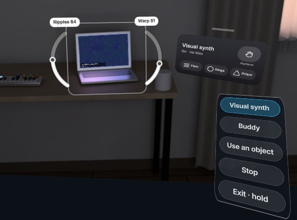

# ControlAnything

**ControlAnything uses SAM and Muse to build XR controls for the devices around you. Muse writes a declarative interface from available connections and device knowledge; camera or microphone checks gate the controls you can enable.**

XR gives natural control with hands, head, immersive visuals and spatial audio, yet most devices and technologies have no XR interface at all. ControlAnything connects a Meta Quest 3 to supported device transports through a helper. Tag a device and choose to set it up: the agent links to it, generates commands grounded in device reference data, checks their observable effects, and builds controls. The current primary demo is a silent visual instrument on the paired Mac; arbitrary-device plug-and-play and physical synth/IR acceptance remain future milestones.

A WebXR app and a Node/TypeScript server on your Mac, built for the **Meta Global AI Developer Hackathon**, Indie Developer track, *Push the Frontier*. It includes control paths for a USB synthesizer via the Mac, an infrared light and the laptop itself. The simulated room exercises device control and verification; physical USB synth and IR verification still need hardware testing. No hardware? Start with the simulated room below. (The name nods to Meta's *Segment Anything*; this is an independent project, not a Meta product.)

<!-- VIDEO_URL -->
**▶ 3-minute demo video:** _link coming Wednesday Nov 4_

<p align="center"></p>

## Two modes, chosen by you

When you enter AR, pair a helper by looking at the QR code on your Mac's `/pair` page, type its code, or choose **Skip for now**. The guide then explains how to tag a device. Pairing alone never requests synth permissions or starts a device test.

1. **Find devices (Annotate)** starts when you enter AR. On-device YOLOX draws fast boxes around nearby devices; SAM 3.1 adds device outlines, including lights. Open **Menu** to choose **All / Electronics**. At most **3 untagged detections** appear, within **3 m** and in front of the headset using estimated positions; people are excluded. Duplicate boxes are suppressed and unseen estimated positions fade. A pinch selects a device; it does not measure its depth. Pinch a box to tag it. Muse Spark quietly names the device. Tagging never starts linking, learning or testing.
2. **Use devices (Control)** starts when you choose it from **Menu**. Untagged boxes disappear. Tagged devices show **Ready**, **Needs setup** or **Not connected**. Select a device to open its card; if a bridge is missing, it explains what to connect. **Set up control** starts:

   `link → learn/research → drive → verify (camera/mic) → forge → Enable controls`

   The server finds the connection, learns remote codes or consults device data, generates a declarative driver, tests its actions and builds controls from the verified results. Tap **Enable controls** to use them.

The **ControlAnything Menu** pill opens **Find devices**, **Use devices**, **Try visual synth**, **Ask Muse**, **Identify here**, **Muse Canvas**, **Pair a helper device** and **Exit AR** (hold). Raise your left palm toward you for a moment to bring the menu into reach; controllers can use their menu button. **Recenter panels** recenters the workspace. Pinch the Menu, device-card or Muse-conversation title to move that panel. During Perform, palm recall is paused so musical gestures do not navigate away; use the Menu button deliberately. Open panels stay in place while you reach for them. Use a near poke or aim and pinch with either hand; index-fingertip dots brighten on pinch, and a target outline shows the selection. **Details** holds logs and evidence. Restoring saved devices leaves their cards closed until selected.

**Device commands require a tagged device, Control mode, a connected bridge and your request.** A successful send is not proof: the camera must see a change or the microphone must hear one. Unverified actions stay disabled and are omitted from the main device card. Ready requires a currently verified visible control; Mac playback is unavailable while silent mode is on. **Stop** cancels setup, disarms controls, drops pending work and stops automations. Returning to Annotate closes the controls and cancels unfinished setup; completed controls remain armed for your next visit to Control.

## Judge path (no hardware)

Requires **Node 22.12+** (developed on Node 26) and **Chrome**. The sim provides a ceiling light, remote, synth, camera frames and audio features through the same protocol as physical devices.

```sh
npm install
cp .env.example .env        # optional MODEL_API_KEY for live Meta calls
CE_MAC_SILENT=1 CE_MAC_LOCAL=0 npm run demo:sim -- --fixture
```

Without a key, **FIXTURE** mode replays recorded responses, labelled with their original model. Omit `--fixture` to use the key, or pass `--live` to require live calls. The launcher builds missing web apps; `--build` forces a rebuild.

1. Open [the sim room](http://localhost:8787/sim/?mute=1&autopress=1) first. It pairs automatically on localhost. `mute=1` keeps speakers silent; `autopress=1` presses the virtual remote buttons requested during learning. Remove `autopress` to press them yourself.
2. Open [the desktop Quest emulator](http://localhost:8787/quest/?emulate=1&camera=sim&mute=1&mic=0) and choose **Enter AR**. The sim acts as the helper. In **Find devices**, point at the ceiling light and click or press `L` to tag it.
3. Open **Menu**, choose **Use devices**, select the tagged light and choose **Set up control**. Watch learning and verification, then **Enable controls** (`A`). Move the control and watch the lamp respond. **Stop** (`X`) stops the run. The desktop `M` shortcut also switches modes.

Automated checks need installed Chrome and built apps; they launch their own muted fixture servers and clean up afterward:

```sh
npm run build
npm run e2e:judge           # find → tag → use → setup → verify → enable → change light
npm run e2e:flows           # adds onboarding, explicit menu, pairing, reconnect, placement, Stop, and hand input
```

They use ports **8796/8446** and **8797/8447**, respectively. Screenshots and diagnostics go to `research/screens/v2-flow/` and `research/screens/v2-flows/`. These checks disable YOLOX and use server fixture detections; they do not establish detector accuracy, physical synth verification or headset frame rate.

Inspect `/api/muse/calls` for model ids, latency and tokens; `/api/agent/steps`, `/api/agent/exec` and `/api/agent/targets` show progress, commands and evidence. [Sim and replay details](apps/sim/README.md).

## Try it without hardware: the visual synth

The **ControlAnything Visual Synth** is a silent WebGL2 instrument: Warp bends a flowing field, and three pattern buttons change its appearance. Setup sends MIDI-style commands to a virtual output and verifies the laptop screen with the headset camera. No microphone, speaker or physical synthesizer is needed.

```sh
npm install
npm run build
MODEL_MODE=fixture CE_MAC_SILENT=1 CE_MAC_LOCAL=0 npm run start
```

Open [the sim room](http://localhost:8787/sim/?mute=1), [the visuals](http://localhost:8787/vsynth/), and [the Quest emulator](http://localhost:8787/quest/?emulate=1&camera=sim&mute=1&mic=0&yolo=0) in the same Chrome profile. Choose **Enter AR → Menu → Try visual synth**, then **Set up control**. This selects the known virtual instrument directly; it does not identify the laptop as a synthesizer. Keep the screen in view while the camera checks the changes. Choose **Enable controls**, move **Warp**, try the patterns, and choose **Stop** to restore the default visuals. The fixture controls use an explicitly labelled local template; camera verification still measures the rendered screen.

For a real Quest looking at your Mac, keep [the paired companion](http://localhost:8787/companion/) open and choose **Open visuals** in its visual-synth row. Keep that visuals window visible. In AR, choose **Menu → Try visual synth**, center the Mac display in the guide and choose **Set up control**. The guide is an aiming aid; verification uses the center of the camera image. Only the companion that opened the visible renderer advertises an available virtual output, without requesting USB MIDI permission. After verification, choose **Enable controls → Perform**. Hold a left fist and move your right hand to change the visuals; release the fist to pause, or open both palms to stop. Opening the webpage alone does not enable hand control.

`npm run e2e:vsynth` runs this sequence in installed Chrome on isolated ports **8798/8448**. It checks camera verification, generated controls, a measurable pixel change inside the sim laptop screen, and Stop restoring the defaults. Screenshots and failure diagnostics go to `research/screens/vsynth/`. The first check is that the sim advertises the connected **ControlAnything Visual Synth** port and renders a nonblank laptop screen.

The next acceptance milestone combines the real Quest, live Muse calls and the real Mac display in one continuous run. Use the [acceptance and recording guide](docs/DEMO-ACCEPTANCE.md); existing fixture runs and separate live generation results do not establish that combined result. Measure total setup time in that run rather than adding or substituting individual model-call benchmarks.

## Review hand and head recordings

Open [Motion lab](http://localhost:8787/companion/tracking/) from the Mac companion to inspect recorded Quest video alongside hand skeletons, head pose and motion trails. Import a take ZIP, scrub the shared timeline, inspect tracking gaps, and export timestamped telemetry and interaction events for dataset preparation. **Explore sample** uses clearly labelled synthetic data.

The Quest recorder captures the prepared passthrough video stream without audio and samples WebXR poses at up to 30 Hz. This is a local review tool for recorded runtime estimates; it does not infer poses from ordinary MP4s or establish training-data accuracy. See the [recording guide and coordinate conventions](docs/TRACKING-REVIEW.md). `npm run e2e:tracking` checks a real browser encoder and the complete import/playback/export path using generated video and poses.

## Watch Muse build controls

During **Set up control**, the selected Quest card shows the actual connection, research, command generation, effect checks, interface generation and enablement stages. The Mac companion shows the same setup with a larger preview of the generated driver and interface. These are validated declarative command definitions, not arbitrary executable JavaScript. Complete generated pieces appear as they arrive; there is no simulated typing or estimated completion percentage.

The preview labels recorded fixtures and saved content when the server reports them. A successful command acknowledgement is separate from a verified device effect, and verification does not enable controls: choose **Enable controls** in the headset. Cancelling or retrying clears the previous attempt; changing devices shows only the selected device’s progress.

## Manual area identification

Choose **Menu → Identify here**, then point with your hand and pinch two opposite corners around an object. Automatic discovery pauses; only the selected image area is sent for detection. When results appear, pinch the intended outline to tag it. Opening Menu cancels the selection or pending result. **Find devices** resumes whole-view discovery. Cropping narrows the search; it does not guarantee recognition or measured room depth.

## Ask Muse in XR

Prepare **Camera + mic** before entering AR and allow microphone access. Tag a device, choose **Menu → Use devices**, select its card, then tap **Ask Muse**. Speak and tap **Send**; you do not need to keep pinching while speaking. Recording stops automatically after 20 seconds. **Menu → Ask Muse** opens a general conversation without assuming the currently selected object. **Read full request / reply** pages through complete text. The panel distinguishes working, review and applied states; opening Menu does not silently discard a request already being generated.

For an OP-1 Field connected through a paired Mac, say so explicitly. Muse offers **Choose instrument** after checking its MIDI port; confirmation creates a separate instrument target rather than relabelling the Mac. Firmware, a reviewed incoming MIDI chart and physical effect verification are still required before controls can be enabled. Unsupported requests to invent new visual-synth effects report that no new mapping was applied; the existing Warp map is not presented as the requested effect.

Try: **“Connect this synth and make raising my right hand control the filter.”** Muse interprets the request for that selected device, uses the existing connection and verification flow, and shows any helper or cable steps on its card. Choose **Enable controls** after verification. Muse then proposes a mapping to supported hand movements; review it and choose **Apply mapping**, then **Perform**. You can also ask about an already connected device or request a different mapping.

Replies appear as text in the headset. This prototype has no wake word or spoken replies. Supported movements are right-hand height, wrist rotation, pinch opening, distance between hands, and the existing right-hand poses. Unsupported motions or unverified device actions are not enabled. Changing selection, leaving AR, or stopping control cancels the current request. The Mac remains silent.

`npm run e2e:voice` checks the combined request, device verification, explicit enablement, mapping acceptance, reuse without additional planning, and gesture performance against the silent visual synth on isolated ports **8799/8449**. It uses a mocked microphone and a labelled fixture planner. Ask Muse speech worked in the real headset test; physical-device control and the revised menu placement still require headset acceptance.

## Make a game with an object

In **Find devices**, choose **All** to include books, cups, bottles and balls. Tag one, choose **Use devices**, select its card and choose **Make a game**. Muse drafts a small game inspired by that object. Read the preview, then choose **Play**. It needs no device connection. Ask Muse **“make this game harder”** to revise it; each new version returns to preview before play.

On Mac Home, **Object games** sits below Devices; choose **Open Canvas** to see the shared game and score, a text box for changes and revision restore. Starting a game for a selected object opens it contextually; **Hide Canvas** keeps it closed through later status updates. Up to eight revisions per object are kept locally. Object games support short choice games with feedback and scores (one to six rounds). Muse uses the selected object's known label and visible evidence; it does not claim to know unread book pages. Games never send device commands or enable hardware controls.

For generated webpages in the headset, choose **Quest Menu → Muse Canvas → Create webpage / Open webpage in headset**, or use the launcher’s **Open Muse Canvas** link. The full studio opens in the headset browser: describe an idea, generate, then explicitly **Run preview**. **Return to AR** preserves the project. Browser point/pinch works in flat mode; custom WebXR hand-position input pauses outside AR. Alternatively, run the preview on Mac and keep Quest in AR to control the same project’s declared inputs with your hands. See the [Muse Canvas guide](docs/MUSE-CANVAS.md) for the action bridge, sandbox and current limitations. `npm run e2e:projects` checks this separate software-project path with fixtures.

`npm run e2e:canvas` checks the XR buttons, shared Mac play, Ask Muse edits and revision restore using an explicitly inserted book fixture on isolated ports **8801/8451**. It does not test physical book recognition. Screenshots go to `research/screens/canvas/`.

## Reusing interactions and research

Muse keeps a small local interaction memory alongside the saved device library. It searches that knowledge before generating controls:

- An accepted gesture request for the same device and unchanged action contract can return its saved mapping without new planning or mapping calls. It still shows a fresh **Apply mapping** preview; speech transcription still runs.
- Different requests receive up to three compatible accepted mappings as examples. Interface generation and editing retrieve relevant layouts and gesture preferences from active saved setups. The current request and current controls take priority.
- Curated device charts remain first choice. Successful web research with citations is cached for seven days; An explicit setup rerun bypasses that cache. Citations and research dates remain attached.

Memory uses bounded local JSON and lexical/action matching, with no embedding service or vector database. Only applied gesture proposals are learned. Retrieval rechecks the current driver contract and verification; it cannot enable a device or create control capabilities. **Forget** removes a device's learned mappings and library examples. The stores are `interaction-memory.json` and `research-cache.json` beside `library.json` in the server data directory.

## Add a reviewed MIDI chart

For an instrument without a supported chart, open the Mac companion's **Details → Reviewed MIDI chart**. Select the exact tagged instrument, cite its incoming-MIDI manual (title, HTTPS URL and page/section), and enter its channel and documented CC parameters/ranges. Confirm that the reference matches that model before choosing **Save reviewed chart**. The chart is stored for that selected instrument; saving sends no device commands and does not enable controls.

Retry setup from the Quest to generate commands against the reviewed allowlist, then observe effect verification and choose **Enable controls**. An unlisted CC remains unavailable. Web-search prose alone never adds a CC to the allowlist. See the [chart workflow and API](docs/MIDI-CHARTS.md); physical response and the instrument's exact model still need acceptance.

## How Meta's models are used

All server model calls use Meta's API. **YOLOX-Nano is the only non-Meta model**, running locally on the headset for preview boxes; its people class is dropped before boxes leave the worker.

| Model | Runtime job |
|---|---|
| `sam-3.1` | Device segmentation and camera verification outlines. |
| `muse-spark-1.3` | Names tagged devices, researches missing device data, writes and repairs drivers, generates and edits controls, interprets selected-device requests and proposes gesture mappings. |
| `muse-wonder-1.0` | Available in the driver writer/benchmark code; the current production setup allows two Spark attempts and does not reach the third Wonder attempt. |
| `muse-image-1.0` | Optional device-inspired panel textures; never delays enabling controls. Disable with `GEN3D_SKIN=0`. |
| `muse-voice-transcribe-1.0` | Transcribes Ask Muse recordings and speech verification clips. |

After setup, moving a control executes validated driver data with rate limits, without a model call. Voice transcription and edits still use models. Drivers use allowlisted MIDI CCs, learned/library IR codes or declared local operations; generated code is never executed. [Architecture, protocol and verification](docs/ARCHITECTURE.md).

The current Quest card shows one continuous control and up to three buttons. It honors generated slider, knob and lever controls within that stable panel: drag a slider horizontally, turn a knob clockwise with a pinch, or drag a lever vertically. This is a supported shape subset, not arbitrary model-authored 3D geometry; retain that distinction when demonstrating interface edits.

## Run it with hardware

1. **Mac:** start the server and app builds with `CE_MAC_SILENT=1 npm run dev`.
2. **Quest 3:** with developer mode enabled and USB-C connected, `sh scripts/quest-grant-camera.sh` grants camera permission and sets up USB forwarding. Open `http://localhost:8787/quest/` in Quest Browser and **Enter AR**. LAN alternative: `https://<mac-lan-ip>:8443/quest/` (accept the development certificate).
3. **Helper:** open [the pairing page](http://localhost:8787/pair) in Chrome on the Mac. Look at its QR code with the Quest, or enter its code in the headset. The companion confirms pairing and sends you back to the headset to tag devices. **Menu > Pair a helper device** reopens this flow. Once a headset owns the room, new Mac helpers need its approval.
4. **Synth, when chosen:** confirm the exact instrument model and firmware first; a port named `OP-1` does not distinguish the original OP-1 from OP-1 Field. Tag it, open **Menu > Use devices**, and select its card. Connect it over USB with MIDI input enabled and allow USB MIDI in the companion when needed. Setup cross-checks port and identity evidence against device data. The checked-in OP-1 Field chart must not be assumed to apply to an unconfirmed model. Pairing alone does not start tests; physical acceptance follows the [single-action check](docs/DEMO-ACCEPTANCE.md#physical-instrument-follow-up).
5. **IR light:** flash a Cardputer with `cd firmware/cardputer && pio run -e cardputer -t upload` (`cardputer-adv` for Adv; hold **G0** during first connection when replacing firmware). Connect it to the Mac and attach an IR receiver to learn your remote. [Firmware and wiring](firmware/cardputer/README.md).

[Mac companion](apps/companion/README.md), [server and pairing API](apps/server/README.md), [DevTerm](apps/devterm/README.md); the iPhone project is `apps/iphone/ControlEverything.xcodeproj` (iOS 17+). Pair other clients with their QR code or passcode. Use your own devices on a trusted network; this is not for safety-critical equipment. Physical hardware results require a hardware session; the fixture checks demonstrate the simulated path.

For shared headset debugging, `npm run quest:live` opens a separate silent USB video feed at [the local live viewer](http://localhost:8790/). [Setup, privacy, and current-frame access](docs/QUEST-LIVE.md).

Development checks: `npm run typecheck`, `npm test`, `npm run build`. `npm start` runs without watch; `npm run smoke` checks pairing and message relay against a running server. Default HTTP/WS is **8787**, HTTPS/WSS **8443**; override with `HTTP_PORT` / `HTTPS_PORT`.

## Built during the hackathon

The application code, clients, firmware, prompts, device data and simulated room were built during the Meta Global AI Developer Hackathon, starting Oct 26, 2026, for submission by **Nov 5, 11:00 JST**. The commit history is the build log. Hardware, pretrained models and third-party libraries/assets below were not built by us.

## Licences and credits

Repository code: **MIT**. Direct npm runtime dependencies are listed here; versions and transitive dependencies are in `package-lock.json`.

- **YOLOX-Nano**, Megvii: **Apache-2.0**, bundled local detector; [model notice](apps/quest/public/models/LICENSE-yolox.txt). **onnxruntime-web:** MIT.
- **three** (three.js), **troika-three-text**, **zod**, **express**, **ws**, **selfsigned**, **qrcode:** MIT. **jpeg-js:** BSD-3-Clause. **jsqr:** Apache-2.0. **@meta-sam/parser:** Meta's package licence (`SEE LICENSE IN LICENSE` in the lockfile).
- **In-headset widgets:** **@pmndrs/uikit**, **@pmndrs/uikit-horizon** (pmndrs' Horizon kit, implementing the look of Meta's Reality Labs Design System), **@pmndrs/uikit-lucide** and **@pmndrs/pointer-events**: MIT, © 2024 Bela Bohlender / pmndrs (dependencies yoga-layout, @preact/signals-core: MIT). **Lucide** icon artwork: ISC, © Lucide Contributors. **@iwsdk/xr-input** (Meta Immersive Web SDK input): MIT, © Meta Platforms, Inc. and affiliates.
- **Design references (no code copied):** Google **XR Blocks** (Apache-2.0; Li et al., "XR Blocks: Accelerating Human-centered AI + XR Innovation", arXiv:2509.25504): grayGlass panel colours, lazy-follow and appear timings, touch rules. **NVIDIA XR AI** (Apache-2.0): the agent response contract (acknowledge only after a delay, streamed replies). Our arc dials, setup ring, device card layout and hand rings are our own code built on these.
- **Fonts:** Inter in the current Quest HUD and Mac companion; Chakra Petch and Share Tech Mono in the Quest launcher/legacy renderer and sim. All supplied by **@fontsource**, **SIL OFL-1.1**. The Quest also bundles an Inter derivative for tabular numerals; [font notice](apps/quest/public/fonts/README.txt).
- **Development/emulation:** Vite, IWER and @iwer/devui (MIT). **DevTerm:** Project Nayuki's QR generator (MIT). **Firmware:** M5Unified, M5GFX, M5Cardputer, ArduinoJson (MIT); Arduino-ESP32 and IRremoteESP8266 (LGPL-2.1).
- **Device data:** [source URLs and provenance](apps/server/data/devices/README.md); midi.guide / pencilresearch MIDI data (CC-BY-SA-4.0), Flipper-IRDB (CC0), SmartIR (MIT). Manufacturer facts are transcribed, not manuals reproduced. Unknown remote codes are learned from your remote.
- **Sim room:** our procedural Blender scene, with no third-party scene assets. Model names are descriptive; not affiliated with or endorsed by Meta.
