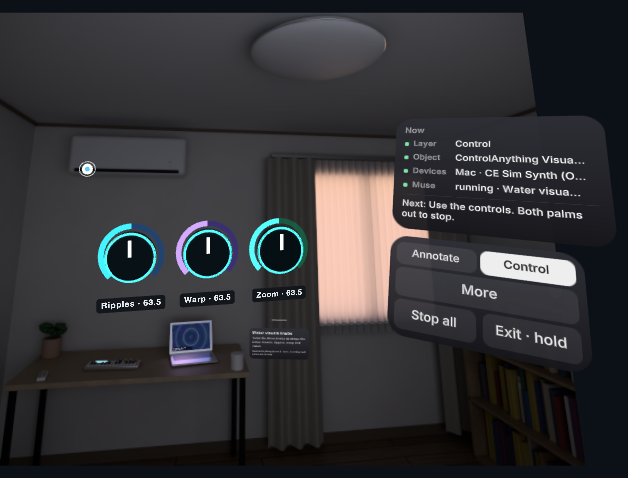

# ControlAnything

**Pinch a device, ask Muse what your hands should do, and watch it write the connection.**

Pinch a device in your Quest 3 passthrough and ask what you want to do with it. A Muse agent on your laptop writes, tests and deploys the code that connects them, then hands you controls in AR: knobs, keys, pads or your bare hands.

How it works in one line: Meta **SAM 3.1** outlines the objects around you; you select one and ask (by voice or a suggestion); the **Muse agent** (Muse Spark with a real terminal, files and device tools on the Mac) writes a connector, runs it, tests it on the device and designs the AR instrument; you watch its code stream in AR and then play. It is meant for any device your laptop can reach (USB, MIDI, serial, Bluetooth or the network); nothing is device-specific. Demonstrated with the built-in visual synth, a third-party app (Instagram Reels in Chrome), a Teenage Engineering OP-1 Field over USB-MIDI and a DJI Osmo Mobile 4 over Bluetooth, plus a virtual pet and a hand-pose recorder for physical-AI data.

<!-- VIDEO_URL -->
**▶ 3-minute demo video:** _link coming soon_

<!-- lead: swap for a real Quest still after recording -->
<p align="center"><br><sub>Live run with Meta's Muse Code engine in the desktop emulator (sim room), Nov 5: the knobs Muse generated for the visual synth. Not a headset capture.</sub></p>

Built for the **Meta Global AI Developer Hackathon** (Indie Developer track, *Push the Frontier*). The name nods to Meta's *Segment Anything*; this is an independent project, not a Meta product.

## Run it in 3 commands (no headset, no key)

```sh
git clone https://github.com/Apolotary/controlanything && cd controlanything
npm install
npm run demo:sim     # Node 22.12+ and Chrome; serves http://localhost:8787 with sound on
```

After `npm run demo:sim`, open `http://localhost:8787/sim/` (the simulated room; it stands in for your Mac), then `http://localhost:8787/quest/?emulate=1&camera=sim&mic=0` (the headset emulator) and choose **Enter AR**. Click the laptop's outline, press `M` for Control and choose **Give me knobs for this**. Without a key every model answer is a recorded or scripted replay, labelled **FIXTURE**. The full walk-through is the [judge path](#judge-path-no-hardware).

**What to look for while it runs:**
- The **LIVE / FIXTURE / TEMPLATE** badge on the AR code card says who wrote the code: a Meta model just now, a recorded replay, or a labelled template.
- In a LIVE run the code card's header names the model (*muse-spark-1.3 is wiring "…"*), and so does the status line on the Mac companion (`/companion/`). A FIXTURE run says *Recorded wiring* instead.
- `/api/muse/calls` lists every model call with its model id, latency and tokens (localhost or a paired device only).
- `/api/agent/connectors` shows the connector Muse deployed: its process, entry file, actions and recent logs, plus which agent engine ran (localhost or the owner only).

## The demos, and where each is verified

| Demo | What happens | Verified |
|---|---|---|
| **1. Built-in visual synth** | Touch the water on the laptop's screen and ripples follow your fingertip; or ask for knobs. Muse writes the connector (MIDI CCs to the browser renderer) and the touch program; two-corner screen calibration comes first. | **Real Quest**, live Muse, confirmed by the user (Nov 4; generation about 45 s). |
| **2. A third-party app: Instagram Reels** | Swipe your right hand up or down to scroll Reels in Chrome. Muse writes a connector that opens Reels on the Mac and presses arrow keys in the front app. macOS needs Accessibility permission for the app running the server. | Not yet verified on the Quest. <!-- lead: update after readiness report --> |
| **3. OP-1 Field over USB-MIDI** | Ask for keys and knobs. Notes and CCs go from the AR controls through the Mac companion's Web MIDI to the synth. | **Real Quest + physical OP-1** (Nov 4), after MIDI receive was enabled on the OP-1, with the earlier instrument UI. The revised generated UI: not yet on the headset. |
| **4. DJI Osmo Mobile 4 over Bluetooth** | Ask for pan and tilt. Muse writes a gimbal connector and a right-hand pan/tilt program; the bridge clamps speed and range. | Direct Bluetooth pan/tilt/recenter on the **real OM 4** (Nov 4). Live Muse wrote the connector and the right-hand program in 34 s, tested against a test double, not the real gimbal (Nov 5). **Not yet:** Muse-driven moves on the real gimbal. <!-- lead: update after readiness report --> |
| **5. Buddy, a virtual pet** | Wave, pet or high-five it; show it a real object (photo preview, then **Show Buddy**) or a virtual one. Muse Spark writes its reaction and Muse Image paints a sticker. | Emulator and browser checks (FIXTURE). A live take on the Quest: not yet. <!-- lead: update after readiness report --> |
| **6. Physical-AI recording** | Record passthrough video plus head and 25-joint hand poses at up to 30 Hz, review video and 3D hands side by side in **Motion lab**, and export a dataset. | Browser check with a synthetic video stream (`npm run e2e:tracking`). A real Quest take reviewed in Motion lab: not yet. <!-- lead: update after readiness report --> |

Also checked: the browser musical synth's **Air Theremin** on the **real Quest** with live Muse (Nov 4, about 37 s). The generated instrument UI (keys, pads, XY surfaces, knobs) passed emulator checks, and one live Muse Spark probe produced it in 30.4 s with fake MIDI acknowledgements; it has not yet been tried on the headset. The camera and webcam pages below are browser-checked with synthetic video only, not on real phones or webcams.

Muse tests connector actions and reports the acknowledgements. Those receipts show that the software and transport worked, not an independently observed physical effect. Separate measurements, not one continuous run: an earlier dial build on the real Quest had a p95 frame time of 12.3 ms (about 81 fps) and applied 100/100 commands (Nov 4); live wiring probes reached ready in 8.1 s (*Touch the water*) and about 11 s (*Hands as knobs*). These and the Nov 4 confirmations are not yet a recorded end-to-end acceptance run of the current ask → code → calibrate → touch route. Checklist and evidence ledger: [docs/DEMO-ACCEPTANCE.md](docs/DEMO-ACCEPTANCE.md).

## No headset? Use your camera

- **`/quest/reviewer.html`** on the running server works with a laptop webcam or a phone camera: an animated Buddy with explicit photo preview and retake, and the same Muse coding-agent path to touch-playable software instruments. Choose **Connect demo → Ask Muse to build it**; no controls are pre-wired. A browser with native mobile WebXR also offers **Place Buddy in AR**; other browsers use camera + touch and say so on screen. See the [reviewer guide](docs/REVIEWER-DEMO.md) for HTTPS, pairing and fixture labels.
- **`/quest/hands.html`** tracks your hands in a mirrored webcam view with classical computer vision (no AI model), draws particle visuals around them, and uses the same Muse ask flow. See the [hands demo](docs/HANDS-DEMO.md). <!-- lead: update after hands report -->

## The golden path

ControlAnything has two layers. **Annotate** looks at the room: SAM 3.1 outlines objects in passthrough, your hands are tracked, and a pinch tags (and keeps tracking) the object you mean. **Control** is where the **Muse agent** on your Mac writes the connection: you ask, Muse codes, tests and deploys the glue, and the controls appear in AR.

1. **Enter AR and tag an object.** Annotate is the default. Pick **Electronics / Objects / All** in the wrist menu (raise a flat left palm). Pinch an outline to tag it; you stay in Annotate. A **Now** panel beside the wrist menu shows the layer, the object, the devices, what Muse is doing and the next step.
2. **Choose Control.** The selected object's card asks what you want. If it needs a companion (a USB-MIDI synth needs the Mac), the card says so and offers **Connect Mac**: look at the QR code on the Mac app with the headset, then plug the device into the Mac. There is no Set up / Enable ceremony first.
3. **Ask Muse.** Tap a suggestion or hold the mic and say it: *"Give me knobs for the filter"*, *"Play it with my hands"*, *"Write a controller for the visual synth"*, *"Touch the water"*.
4. **Watch Muse work.** The Muse agent (Muse Spark with real tools) looks at the snapshot of the object, uses a terminal on the Mac, writes a connector program, starts it as a background service, sends test values to the real device and reads the acknowledgements, fixes what fails, and keeps notes for next time. Its terminal and code stream into a card beside the device; the Mac speaks its progress lines.
5. **Use the controls it made.** Generated **AR keys, pads, XY surfaces and colored controls** appear between you and the device: pinch a knob and twist it like a real one, or pinch and drag up/down. If you asked for hand control, Muse's hand program runs in a sandboxed Worker on the headset (screen-touch programs ask you to calibrate two screen corners first).
6. **Stop.** Both palms out stops the current controls and shuts the connector down; ask again for something new. **Stop all** in the wrist menu stops everything; hold **Exit** to leave AR.

### The Muse agent (a coding agent on the Mac)

`apps/server/src/agent/muse-agent.ts` is a Hermes-style agent loop on the Meta Model API (`muse-spark-1.3`, function calling, streamed). Its tools:

| Tool | What it does |
|---|---|
| `bash` | Runs shell commands in its workspace on the Mac (inspect, `npm install`, run scripts and tests). Obvious system-level/destructive commands are filtered; the process still has the Mac user’s OS permissions. |
| `read_file` / `write_file` / `edit_file` | Reads the workspace and this repo; writes only inside the workspace. Files stream into AR as they are written. |
| `deploy_connector` | Starts `node <entry>` as a background service for the selected device and declares the actions it accepts. A crash on start comes back with its stack trace. |
| `test_action` | Sends a value to the running connector, exactly as an AR control would, and returns the connector's log plus the device acknowledgements from the Mac companion. |
| `open_visuals` | Opens the visual synth on the paired Mac. |
| `say` | One progress line for the wearer (shown in AR, spoken by macOS speech). |
| `finish` | Hands over AR controls bound to connector actions, and/or a hand program; the server validates and dry-runs the program and sends back any issues to fix. |

The workspace (`apps/server/.data/muse-agent/`) persists: `connectors/<device>/index.mjs`, `NOTES.md` (its memory), and `ce.mjs`, the small runtime a connector imports (`onSet`, `onTrigger`, `onStop`, `midi.cc/note/program`, `gimbal.*`, `mac.open/key`, `log`). MIDI goes out through the paired Mac companion's Web MIDI (USB synths, plus the built-in visual and musical synths); the gimbal goes through the Osmo bridge; anything else (HTTP to a lamp, `say`, a serial port) the connector does itself in Node. Owner/localhost status: `GET /api/agent/connectors`. Limits: 24 turns, 40 tool calls, 5 minutes per request. Without an API key the same tools replay a scripted **FIXTURE** run.

**Muse Code engine (opt-in).** With `CE_AGENT_ENGINE=muse-code`, Meta's **Muse Code** CLI (`muse exec`, Meta provider, `muse-spark-1.3`) runs the whole agent loop with its own shell and file tools. It reaches the device tools above (`say`, `open_visuals`, `deploy_connector`, `test_action`, `finish`) through a loopback MCP server with a per-run token, so they get the same checks; its commands and files stream into the same AR code card. It is opt-in: the default is the built-in loop, which also runs instead with no key, no Muse Code binary, or in fixture mode; `/api/agent/connectors` reports which engine ran. Verified live in the emulator on Nov 5: every model call was `muse-spark-1.3` and the ask reached working knobs in about 30 s (the [evidence frames](docs/evidence/README.md) and the hero image come from that run). Other runs took 38–73 s. <!-- lead: confirm 38–73 s -->

**Older harness.** `CE_AGENT=0` restores the earlier bounded wiring harness and setup flow. It labels each check: **seen ✓** (the headset camera saw the change: before/after frames inside the outline, no model), **renderer ✓** (the Mac's renderer reports what it applied), **acknowledged ✓** (only the executor's acknowledgement) and **not seen ✗** (failed; that control stays locked). In the emulator the camera usually does not see the Mac's screen change, so those passes say *renderer ✓* or *acknowledged ✓*.

## Meta model calls vs. OS and browser features

**Every AI model this project calls at runtime is a Meta model**, called through Meta's Model API. The application does not call or bundle a non-Meta model. Platform tracking and system voices are described separately below. A FIXTURE run (no key) calls no model and says so on every card; a LIVE run calls the models below and logs each call at `/api/muse/calls`.

| Meta model | What it does here |
|---|---|
| **SAM 3.1** (`sam-3.1`) | Finds and outlines the devices and objects in passthrough frames: every box you see comes from it. During verification it finds the same outline again on the before and after frames. |
| **Muse Spark** (`muse-spark-1.3`) | Drives the **Muse agent**: with terminal, file, deploy and test tools it writes, runs and fixes the connector for the selected device and generates its AR controls and hand program. Identifies the pinched device from a crop and the whole frame. Writes the Muse buddy’s reactions to real camera photos and explicitly shared virtual objects. In the older `CE_AGENT=0` flow it also writes the driver from the device's capability manifest or MIDI chart and the per-request wiring program, with repair when checks fail. |
| **Muse Code** (Meta's coding-agent CLI, running `muse-spark-1.3`) | Opt-in agent engine (`CE_AGENT_ENGINE=muse-code`) that runs the whole agent loop and calls the device tools over MCP; see [the Muse agent](#the-muse-agent-a-coding-agent-on-the-mac). Live in the emulator on Nov 5, all calls `muse-spark-1.3`. Also runs the separate Connector Workshop (`/companion/coding/`). |
| **Muse Wonder** (`muse-wonder-1.0`) | Not called on the default Muse-agent path. A guarded fallback for driver and wiring generation in the older `CE_AGENT=0` flow; only count Wonder as used when a call actually occurred. |
| **Muse Image** (`muse-image-1.0`) | Paints the buddy's stickers. Optionally paints a device-inspired panel texture, which never delays the controls. |
| **Muse Voice Transcribe** (`muse-voice-transcribe-1.0`) | Transcribes the device card’s hold-to-talk wiring request, plus the older lab assistant and spoken verification clips. |

These parts are OS or browser features, or plain code. None of them is an AI model call:

| Part | What it actually is |
|---|---|
| Hand and head tracking | Quest OS hand tracking, read through the WebXR Hand Input API. We read the joint poses and run no hand model of our own. |
| Hand/screen signals and UI gestures | Deterministic geometry on WebXR joints, with smoothing and a calibrated screen plane. Muse’s generated program decides how these signals drive the selected device. |
| Webcam hand tracking (`/quest/hands.html`) | Classical computer vision in a Worker (skin colour, motion, background learning, blobs); no model is loaded or called. |
| An object you hold as a controller | Follows the hand that holds it (WebXR joints). SAM 3.1 finds it first. |
| Camera verification (*seen ✓*) | Deterministic before/after frame comparison inside the SAM 3.1 outline. |
| Passthrough frames | Quest Browser camera access (`getUserMedia`). |
| The Mac visual synth | A WebGL shader with procedural Web Audio splash, wake and hover sounds in Chrome. |
| The Mac musical synth | An authored Web Audio instrument in Chrome; sound requires an explicit Mac click. Muse writes its hand wiring, not the oscillator/effect engine. |
| App voices, reactions and UI sounds | Browser `speechSynthesis`, macOS OS speech, and procedural Web Audio tones/noise; no non-Meta AI voice model. Shared master volume/mute applies across Quest and Mac. |
| Mac speech, key presses and music actions | macOS speech and AppleScript (System Events key presses, which need Accessibility permission, and Music): OS features. Live startup leaves `CE_MAC_SILENT` unset; explicit muted automation can still use it. |
| iPhone spoken replies | The iOS system voice (`AVSpeechSynthesizer`). |
| Device links | Web MIDI, Web Serial and Web Bluetooth (browser), bleak (Bluetooth LE), stored IR codes. |
| QR pairing | jsQR decoding (not a model). |

## What Muse writes, and where it runs

| Artifact | Generated from | Checked and executed where |
|---|---|---|
| **Connector** (Muse agent) | The wearer’s request, the object snapshot, the Mac’s MIDI ports and the instrument manifests | A Node program in the agent workspace, run as a background process on the Mac and tested by the agent against the device. It sends MIDI through the paired companion’s Web MIDI. Stopped on Stop / Stop all / a new ask. |
| **AR controls** (Muse agent) | The connector’s declared actions and the request | A validated 3D instrument specification with keys, pads, XY surfaces, knobs, buttons or toggles, drawn beside the device; each change is a `wire:<action>` control event to the connector. |
| **Driver** | The instrument’s capability manifest or reviewed device/MIDI data | Declarative operations validated on the server against supported transports, action IDs, CCs and ranges. Executors send those operations; driver JSON is not arbitrary executable code. |
| **Wiring program** | The wearer’s current request, available hand/screen signals and verified driver actions | Up to 4KB of JavaScript, validated and dry-run in a restricted `node:vm` context on the server. The accepted program runs every frame in a restricted **Web Worker on the Quest**. It never runs in the Mac companion. |
| **Labels/interface description** | Device actions and the request | Bound to validated actions and rendered in the app’s established AR layout. The current demo does not generate arbitrary 3D scene code. |

The wiring API is `wire(s, out, mem)`: read hand/screen signals, call `out.set(actionId, value)` or `out.trigger(actionId)`, and retain small state in `mem`. The runtime restricts actions, clamps values, rate-limits outputs and stops on repeated errors or a watchdog timeout. The server independently checks active wiring, arming and verification before dispatch. These are prototype guardrails, not a general-purpose untrusted-code platform.

Live generation is the normal keyed route; if Muse cannot finish checked code, the run fails visibly and no template is installed. Older experimental paths can show a **Template**, labelled *no Meta model wrote this*. No-key runs are **FIXTURE**, including scripted tool calls and chunked code playback. Driver-library reuse is labelled separately and does not mean the wiring was newly generated. Every new request asks for a new program; an old hand mapping is never silently restored.

After Muse finishes, each hand frame needs **no model call**: worker output → `control.event` (`wire:<actionId>`) → validated driver → Mac executor/renderer. See [architecture](docs/ARCHITECTURE.md) for the protocol and limits.

## Demo details

- **Musical synth (optional).** *More → Demo: music synth* opens **ControlAnything Synth** on the paired Mac: an authored Web Audio engine (two octaves of C minor, filter, envelope, delay, three presets) with no built-in hand preset. Muse writes the note and parameter mapping after you ask. Both palms, **Stop all**, closing the panel or disconnecting release its notes. It sends no physical MIDI.
- **Instagram Reels.** Tag the laptop in Control and choose **Swipe my hand to scroll Instagram Reels**. The connector opens `instagram.com/reels` in Google Chrome on the Mac and presses the down/up arrow for each deliberate swipe. Allow Accessibility for the app running the server (System Settings → Privacy & Security → Accessibility); without it the connector says so instead of retrying.
- **DJI Osmo gimbal.** A Bluetooth adapter for the Osmo Mobile: DUML framing, a safety envelope (≤ 90°/s, pan ±120°, tilt ±45°) and three links (`CE_OSMO=ble` via a small bleak helper, `web` via Chrome Web Bluetooth, `mock`). For the live demo, start with `CE_OSMO=web` and choose **Connect gimbal** on the Osmo link page on port 8799. Muse's connectors call `gimbal.pan/tilt/recenter`. The OM 4's USB-C port is power only. See the [hardware demo](docs/HARDWARE-DEMO.md).
- **Muse buddy.** *Wrist menu → More → Buddy.* An animated desk companion waves, responds to touch and high fives, and reacts to real or virtual objects. Capture previews the exact photo; Show Buddy sends it, while Retake discards it locally. There are no quests or scores.
- **Hand and head pose recording.** On the Quest it is under `?lab=1`; in the emulator it is in the side panel. Review a take in **Motion lab** (`/companion/tracking/`): video and 3D hands on one timeline, tracking gaps, *Export dataset* for physical-AI training data. See [tracking review](docs/TRACKING-REVIEW.md).
- **Physical objects as controllers.** Once a device is armed, choose *Use an object* and pick a mug or bottle. SAM 3.1 finds it; once you pick it up it follows the hand that holds it (WebXR joints, One Euro filter). This is an earlier deterministic controller mode, outside the Muse-agent demo.
- **Other hardware.** The IR ceiling-light path through an M5Stack Cardputer still needs physical acceptance. Native iPhone, DevTerm and Cardputer clients pair by QR code or passcode; their device acceptance is separate from the browser demos.

## Judge path (no hardware)

Needs **Node 22.12+** and **Chrome**. No API key: without one, the server replays recorded real responses, labelled **FIXTURE**.

```sh
npm install
npm run demo:sim            # builds what's missing; attended demo with sound on :8787
```

After `npm run demo:sim`:

1. Open `http://localhost:8787/sim/` first. The sim room stands in for your Mac: it pairs itself on localhost, and the laptop on its desk runs the visual synth.
2. Open `http://localhost:8787/quest/?emulate=1&camera=sim&mic=0` (the desktop Quest emulator) and choose **Enter AR**. Click = pinch, right-drag = look, W/A/D/Q/E = move.
3. **Click the laptop’s box** to tag it, press `M` (or use the wrist menu) for **Control**, then choose **Give me knobs for this** on the device card. The scripted FIXTURE agent writes a visual-synth connector and returns knobs. Skip **Swipe my hand to scroll Instagram Reels** unless you want it: it is not simulated, it opens Instagram in Google Chrome and presses keys on the Mac that runs the server.
4. Pinch (click) a generated knob and drag it; each change goes to the visual synth on the sim laptop. For the touch route, choose **More → Demo: visual synth**, ask *Touch the water* and follow the two-corner calibration; ordinary mouse clicks are UI pinches, not screen contact, so the automated check below supplies fingertip poses. **Stop** is on the wrist palette or the `X` key. Keys: `G` Visual synth, `1/2/3` Electronics/Objects/All (Annotate only), `B` Buddy.

`/companion/` is the real Mac app; open it in another tab to watch the code and status there. The agent's steps and evidence are at `/api/agent/steps` and `/api/agent/targets`.

- **Evidence without a headset:** [docs/evidence/](docs/evidence/README.md) has frames from a live Muse Code run in the emulator, what was verified on the real Quest on Nov 4, the Nov 5 live runs, and how to read `/api/muse/calls`.

**Automated check** (installed Chrome; its own muted fixture server, own data dir):

```sh
npm run build                         # only while no live AR session is using dist
node scripts/e2e-muse-agent.mjs        # Muse agent golden path: tag -> Control -> ask -> knobs -> MIDI -> Stop
PORT=8796 node scripts/e2e-judge.mjs   # older setup-first water flow (CE_AGENT=0)
node --import tsx apps/server/scripts/wire-e2e.ts  # fixture WIRE over WebSocket
```

For unattended playback, use `npm run demo:sim -- --mute`; attended demos keep sound on after a browser gesture. These checks use server fixture detections. They do not measure detector accuracy, headset frame rate or the real Mac display.

## Run it with hardware

1. **Mac:** put `MODEL_API_KEY` in `.env` for live Meta models; the key stays on the server, which strips secret values from everything it sends to clients. Build before opening the app, then run `CE_DEMO=1 npm start` with `CE_MAC_SILENT` unset (add `CE_OSMO=web` for the gimbal, `CE_AGENT_ENGINE=muse-code` for the Muse Code engine). HTTP serves on :8787 and HTTPS on :8443. The first click/Enter AR unlocks browser audio; a shared visible volume/mute controls the demo.
2. **Quest 3** (developer mode, USB-C): `sh scripts/quest-grant-camera.sh` grants camera access and sets up `adb reverse`. In Quest Browser, open `http://localhost:8787/quest/` and choose **Enter AR**. Over the LAN, use `https://<mac-ip>:8443/quest/` and accept the development certificate.
3. **Companion:** open `http://localhost:8787/companion/` in its own Chrome window, full screen. Look at its QR code from the headset.
4. **Tag, choose Control, then ask Muse.** Plug USB-MIDI devices into the Mac and click **Enable MIDI** on the companion once. Select the object in Control, choose a suggestion or hold-to-talk, and watch Muse write and test the connector; then use the AR knobs or your hands. For the water demo, ask the laptop for the visual synth (or choose **More → Demo: visual synth**). For Reels, allow Accessibility first (see [Demo details](#demo-details)).

While a live session is open, rebuild with `scripts/deploy-live.sh quest` (or `companion` / `sim`), which preserves old chunks. Reload the single Quest tab only after leaving AR; `scripts/quest-reload.mjs` avoids opening a duplicate camera-owning tab.

Checklist and recording guide: [docs/DEMO-ACCEPTANCE.md](docs/DEMO-ACCEPTANCE.md). OP-1 and gimbal procedure: [docs/HARDWARE-DEMO.md](docs/HARDWARE-DEMO.md). Per-app notes:
- [server and pairing API](apps/server/README.md)
- [Mac companion](apps/companion/README.md)
- [sim room](apps/sim/README.md)
- [DevTerm](apps/devterm/README.md)
- [Cardputer firmware](firmware/cardputer/README.md)
- the iPhone project, `apps/iphone/` (iOS 17+)

Use your own devices on a trusted network; this is not for safety-critical equipment.

Development: `npm run typecheck`, `npm test`, `npm run build`.

## Architecture

Quest (WebXR, three.js) ⇄ WebSocket hub ⇄ one Node server on the Mac (Meta model adapters, agent, oracles, forge) ⇄ executors (Mac companion, sim, Cardputer, iPhone, DevTerm, Osmo bridge). The protocol, the agent state machine, the oracles and the generated-controls format are described in **[docs/ARCHITECTURE.md](docs/ARCHITECTURE.md)**.

## Built during the hackathon

The application code, clients, firmware, prompts, device data and simulated room were built during the Meta Global AI Developer Hackathon, **Oct 26 – Nov 4, 2026**, for submission by Nov 5, 11:00 JST. The hardware, the pretrained models and the third-party libraries and assets below were not built by us. The DJI Osmo gimbal adapter (`apps/server/src/devices/osmo/`) is new code written during the hackathon; it draws on public protocol research (below) and on the author's own earlier, private notes on the gimbal's Bluetooth protocol (March 2026, documentation only), from which no code is included.

## Credits and licences

Repository code: **MIT** ([LICENSE](LICENSE)). Versions and transitive dependencies are listed in `package-lock.json`. Full copied notices, their scope and regeneration instructions are in [THIRD-PARTY-NOTICES.md](THIRD-PARTY-NOTICES.md).

- **Meta:** the Quest 3 and its passthrough camera. SAM 3.1 and the Muse models via the Meta Model API. **@iwsdk/xr-input** (Immersive Web SDK input; owns all pointing, poke and pinch): MIT, © Meta Platforms, Inc. and affiliates. Hand and controller meshes from **@webxr-input-profiles/assets** (MIT, © Amazon; [notice](apps/quest/public/xr-profiles/LICENSE.md)). **@meta-sam/parser**: Meta's package licence.
- **In-headset UI:** **@pmndrs/uikit**, **@pmndrs/uikit-horizon** (pmndrs' Horizon kit, after Meta's Reality Labs design system), **@pmndrs/uikit-lucide** and **@pmndrs/pointer-events**: MIT, © Bela Bohlender / pmndrs. **Lucide** icons: ISC.
- **Ideas, no code copied:**
  - Google **XR Blocks** ([google/xrblocks](https://github.com/google/xrblocks), Apache-2.0; Li et al., arXiv:2509.25504): glass panel colours, lazy-follow and appear timings, touch rules.
  - **NVIDIA XR AI** ([NVIDIA/xr-ai](https://github.com/NVIDIA/xr-ai)): the agent response contract (acknowledge after a delay, stream replies).
  - Our arc dials, setup ring, device card and hand rings are our own code.
- **DJI Osmo protocol references, no code copied:**
  - [alkersan/om-research](https://github.com/alkersan/om-research) (MIT);
  - the DUML dissectors in [o-gs/dji-firmware-tools](https://github.com/o-gs/dji-firmware-tools) (GPL-3.0, reference only).
  The optional Bluetooth helper runs **bleak** (MIT) through `uv`. DJI and Osmo are trademarks of SZ DJI Technology; not affiliated.
- **Fonts:** **SIL OFL-1.1**. Inter, Chakra Petch and Share Tech Mono come via **@fontsource**. The Quest also bundles JetBrains Mono and an Inter derivative for tabular numerals ([font notice](apps/quest/public/fonts/README.txt)).
- **Libraries:**
  - **three**, **troika-three-text**, **zod**, **express**, **ws**, **selfsigned**, **qrcode**, Vite, IWER and @iwer/devui: MIT.
  - **jpeg-js**: BSD-3-Clause. **jsqr**: Apache-2.0.
  - DevTerm: Project Nayuki's QR generator (MIT).
  - Firmware: M5Unified, M5GFX, M5Cardputer and ArduinoJson (MIT); Arduino-ESP32 and IRremoteESP8266 (LGPL-2.1).
- **Device data:** midi.guide / pencilresearch MIDI data (CC-BY-SA-4.0), Flipper-IRDB (CC0) and SmartIR (MIT). Manufacturer facts are transcribed; manuals are not reproduced. [Sources](apps/server/data/devices/README.md).
- **Sim room:** our own procedural Blender scene, with no third-party scene assets.

Model and product names are descriptive. This project is not affiliated with or endorsed by Meta, DJI, Teenage Engineering or Apple.
