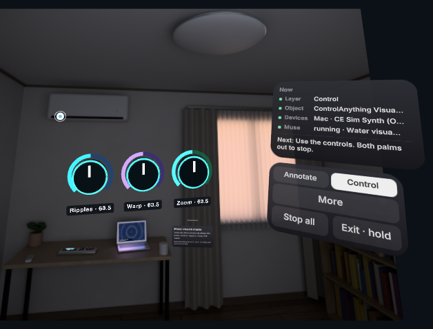

# Evidence

This folder is for checking the work without a headset. It records what was observed, where, and how to see it again yourself.

## Live Muse Code run in the desktop emulator (Nov 5)

**Where these frames come from:**
- Taken by [`scripts/e2e-muse-agent.mjs`](../../scripts/e2e-muse-agent.mjs), run with `LIVE=1` on Nov 5 against Meta's API.
- The server was in live model mode. The page shows a LIVE badge and `server … · live` (frame 00); a run without a key shows FIXTURE.
- The scene is the Quest 3 **desktop emulator** (IWER) with the simulated room and simulated Mac. **These are not headset captures**, and no real room or person appears in them.
- The ask was the script's default: *"Give me knobs for ripples, warp and zoom"*.
- Frames 01–05 are cropped to the AR view. The emulator's control sidebar is removed.

- The agent was **Meta's Muse Code** (`CE_AGENT_ENGINE=muse-code`) driving our device tools over MCP. Every model call was `muse-spark-1.3`. From the ask to the working knobs took about 30 s.

The script takes each frame only after its checks pass:
- Frame 03 comes after Stop Muse cancelled an earlier request in mid-generation and left no connector running.
- Frame 05 comes after the knob moved and the connector logged MIDI CC21 to the sim room's visual synth.

| Frame | What it shows |
|---|---|
| [00-page-status-live.png](00-page-status-live.png) | Page header and status lines from the same run: the LIVE badge, `Quest (desktop emulator)`, `server … · live`. |
| [01-annotate-tagged.png](01-annotate-tagged.png) | Annotate: the laptop is pinched and tagged ("laptop · identifying…"). Nothing is wired yet; the Now panel says to choose Control. |
| [02-control-ask.png](02-control-ask.png) | Control, chosen on purpose. The laptop's card offers Ask Muse; no interaction is pre-wired. |
| [03-agent-writing.png](03-agent-writing.png) | Muse is writing: the code card by the laptop streams its work, and the Now panel shows `Muse: writing`. |
| [04-knobs.png](04-knobs.png) | Muse's connector is running. The three knobs it returned (Ripples, Warp, Zoom) float in the room. |
| [05-knob-turned.png](05-knob-turned.png) | The Ripples knob was dragged with the emulated pinch from 63.5 to 127. |

By the file timestamps, the time from the ask (frame 03) to the knobs (frame 04) was about 30 s.



## Real Quest 3 (Nov 4)

All observed by the user on the headset with live Muse. Details are in [DEMO-ACCEPTANCE.md](../DEMO-ACCEPTANCE.md).

- **Water touch.** Muse generated the visual-synth controller and the water-touch program in about 45 s. It worked on the real Quest.
- **Air theremin.** The browser musical synth was generated live in about 37 s.
- **OP-1 Field.** It played notes and CCs from the headset once MIDI receive was turned on on the OP-1.
- **DJI OM 4.** The gimbal made small pan/tilt/recenter moves from direct Bluetooth commands (the direct test route, not Muse-generated code).

## Real Quest 3, recorded takes (Nov 5)

Each demo was asked by voice on the headset and written live by the Muse agent (`muse-spark-1.3`); the Quest's own screen recorder captured the result. Times are from the server log (ask to ready).

- **Touch the water.** "Touch the water with your finger": a hand program with no floating controls, ready in 31.6 s. The first fingertip touch found the laptop screen; the ripples followed the finger.
- **Instagram Reels (a third-party app).** "Reels hand scroll", ready in 54.5 s. Muse opened Reels in Chrome on the Mac and tested the arrow keys (the reels changed during its own test), then hand flicks and its Next/Prev/Like buttons scrolled Reels.
- **OP-1 Field over USB-MIDI.** Filter knobs plus an AR keyboard, and "Play the OP-1 Field with fingers" (36.7 s). Muse's test notes were confirmed on the OP-1.
- **DJI Osmo Mobile 4 over Bluetooth.** "Gimbal finger steering", ready in 30.0 s. The gimbal acknowledged 889 Muse-driven moves while the hand steered it.
- **Buddy.** Muse Spark reactions in 5.1–5.7 s and Muse Image stickers in 7–13 s for a real mug.
- **Physical-AI recording.** A 111.6 s take: 3,247 head + 25-joint hand frames at 30 Hz, synced with the Quest's video recording.

## Live Muse runs outside the headset (Nov 5)

- **Muse Code engine.** The opt-in engine (`CE_AGENT_ENGINE=muse-code`) passed the live emulator end-to-end run in about 30 s.
- **Readiness runs.** Live Muse wrote the Reels (39 s), OP-1 (52 s) and gimbal (42 s) connectors in the emulator with the Mac and gimbal stubbed, before the headset takes above.

## Not yet verified

- The phone and webcam page (`/quest/hands.html`) on real phones and webcams: it is checked in headless Chrome with a synthetic camera only.
- Muse-written 3D scenes (`finish.scene`) on the headset: checked in the emulator only.

## See the model calls yourself

Run the server, then open these two URLs from the same Mac. Other callers need a token:
- `/api/muse/calls` also answers a paired device's token; otherwise it returns 401.
- `/api/agent/connectors` also answers an approver device's token; otherwise it returns 403.

- **`GET /api/muse/calls`** lists every model call, newest last: model id, live or FIXTURE, latency and tokens. A FIXTURE run (no key) records `model: "fixture"` and calls no model. The shape (values elided):

  ```text
  { "mode": "live",
    "totals": { "calls": n, "failures": n, "promptTokens": n, "completionTokens": n, "reasoningTokens": n },
    "calls": [ { "at": epoch-ms, "label": "muse-agent", "model": "muse-spark-1.3", "source": "live", "ok": true,
                 "latencyMs": ms, "format": "tool_calls", "finishReason": "…", "usage": { … } }, … ] }
  ```

  The server console prints the same as one line per call: `[muse] muse-agent model=muse-spark-1.3 … in=… out=… 1.23s finish=…`.
- **`GET /api/agent/connectors`** shows the connectors Muse deployed and that are running now. For each one it gives the card, the entry file and process, the actions, its last log lines (for example `→ CC21 …`) and the controls it returned to the headset.

## Reproduce

```bash
# No key, no credits: the same path with a labelled FIXTURE agent
node scripts/e2e-muse-agent.mjs
# Live (needs MODEL_API_KEY in .env, which is never printed); this is how the frames above were made
LIVE=1 node scripts/e2e-muse-agent.mjs
```

Each run starts its own server (port 8798 by default; set `PORT` to change it) and needs Chrome installed. The emulator is not the headset: comfort, tracking and frame time can only be judged on a real Quest.
